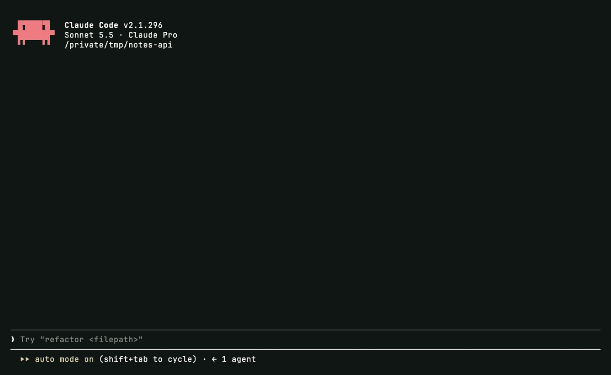

<p align="center">
  
</p>

<h1 align="center">Claude Code plugins</h1>

<p align="center">Small plugins for Claude Code by Tigran Macintosh.<br>One marketplace, add it once and install what you need.</p>

## Plugins

<table>
<tr>
<td width="45%"><a href="brief"></a></td>
<td valign="top">
<h3><a href="brief">brief</a></h3>
Reads every prompt before Claude does. Vague prompts get settled from the code first and only your real decisions are asked, through the question form. End a prompt with <code>??</code> for a full brief from a second model: intent, task, done bar and open questions.
<br><br>
<code>/plugin install brief@tigran-macintosh</code>
</td>
</tr>
</table>

## Install

```
/plugin marketplace add Mhitaryan-Tigran/claude-plugins
/plugin install brief@tigran-macintosh
```

Restart Claude Code after installing. `/plugin` lists what is installed and updates it.

<sub>MIT · Tigran Macintosh</sub>
