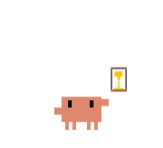
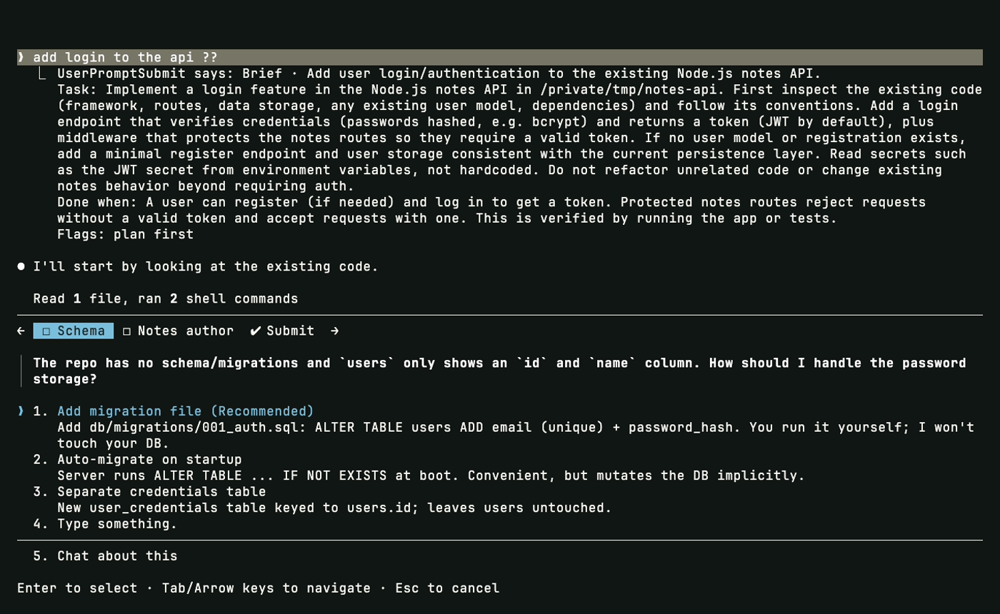
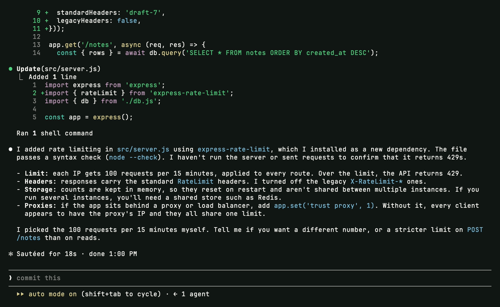
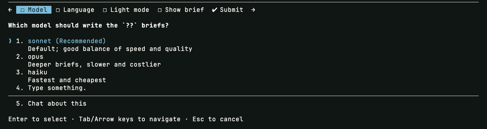

<p align="center">
  
</p>

<h1 align="center">brief</h1>

<p align="center">A layer between you and Claude Code that reads every prompt first.<br>Vague prompts turn into a task with scope, a finish line and the few questions only you can answer.</p>

<p align="center">
  
</p>

## Three ways to send a prompt

<table>
<tr>
<td align="center" width="33%"><br><b>Just type</b><br><sub>no delay</sub></td>
<td align="center" width="33%"><br><b>End with <code>??</code></b><br><sub>full brief, about ten seconds</sub></td>
<td align="center" width="33%"><br><b>Start with <code>,</code></b><br><sub>sent as is</sub></td>
</tr>
<tr>
<td valign="top">Claude checks the prompt is clear enough to do well. If it is, it gets on with it. If not, it settles what it can from the conversation, the code and git, then asks only your decisions.</td>
<td valign="top">A second model reads the recent conversation and writes the brief you see above the answer: what you want, the task in full, what counts as done, notes to read, open questions, and flags for plan-first and outward actions.</td>
<td valign="top">The plugin stays out of it. Short replies such as "yes", "go on" or an answer to Claude's own question are let through the same way.</td>
</tr>
</table>

## The brief

<p align="center">
  
</p>

The brief sits above the answer, so a misreading is visible before any work starts. Its questions are candidates, not orders: Claude answers what it can by reading the code first, and the form only carries what is left. Above, it found no schema and asked how passwords should be stored, with its recommendation first.

## Clear prompts stay fast

<p align="center">
  
</p>

A prompt that is clear enough gets no questions and no delay. Where Claude picked a default on its own, it says so at the end, so you can change it in one line.

## Setup

<p align="center">
  
</p>

`/brief-setup` asks for the model, the language, light mode and whether to show the brief, then a line about who you are, and writes the config.

| Key | Default | Meaning |
|---|---|---|
| `model` | `sonnet` | Model that writes the `??` brief |
| `language` | `English` | Language of the parts shown to you |
| `light` | `true` | The clarify-first check on every prompt |
| `show_brief` | `true` | Show the full `??` brief above the answer |
| `deep_marker` | `??` | Marker at the end or start of a prompt for a full brief |
| `bypass_prefix` | `,` | Prefix that skips the plugin |
| `replies` | yes, ok, go… | Short replies that never trigger it |
| `timeout` | `25` | Seconds the brief may take before the prompt goes through untouched |
| `profile` | empty | A sentence about you, or a path to a markdown file |
| `memory_index` | empty | Markdown index of your notes, links as `[Title](name.md)`, so the brief can point at the right ones |
| `context_command` | empty | Shell command whose output joins every brief, such as a calendar or `git status` |
| `log` | `~/.claude/brief/log.jsonl` | Every prompt with its brief or skip reason; empty turns it off |

Settings live in `~/.claude/brief.json`, and a project's `.claude/brief.json` overrides them.

## How it behaves

- Any error or timeout lets the prompt through unchanged and writes one line to the log.
- The second model runs with no tools, no settings and no MCP servers, so it can read but never act, and it never triggers itself.
- It uses whatever Claude Code is signed in with, a subscription or an API key. Python 3 is the only requirement.

## Install

```
/plugin marketplace add Mhitaryan-Tigran/claude-plugins
/plugin install brief@tigran-macintosh
```

Restart Claude Code and run `/brief-setup`. For updates on their own, open `/plugin` → **Marketplaces** → `tigran-macintosh` → **Enable auto-update**.

<sub>MIT · Tigran Macintosh</sub>
