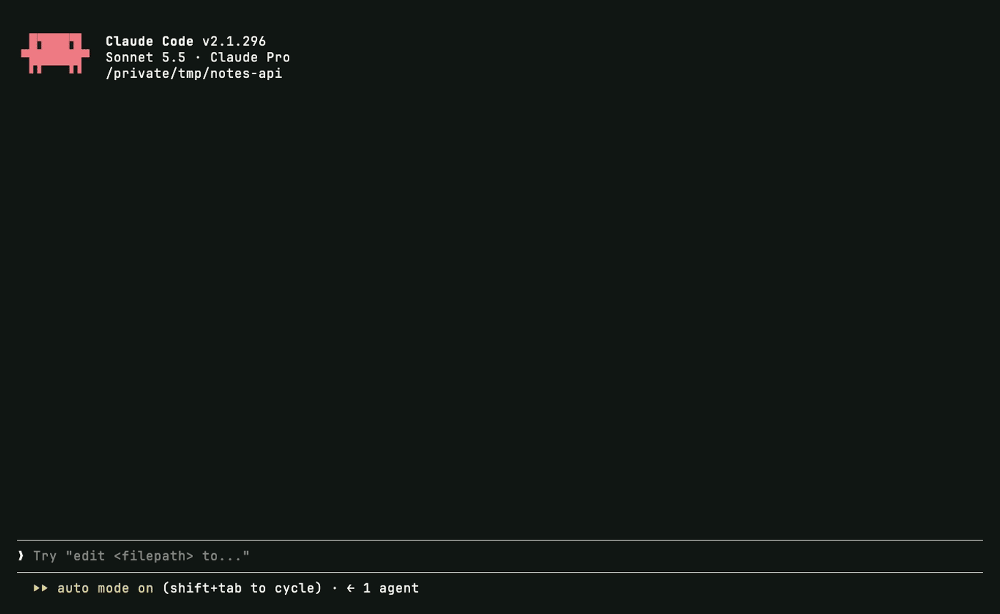
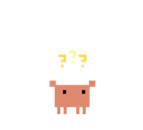
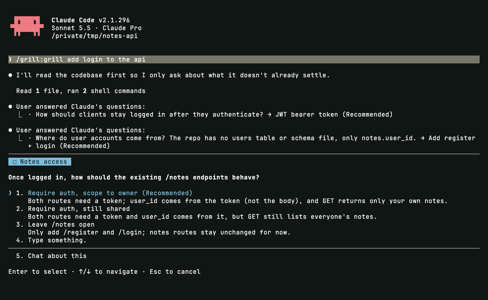
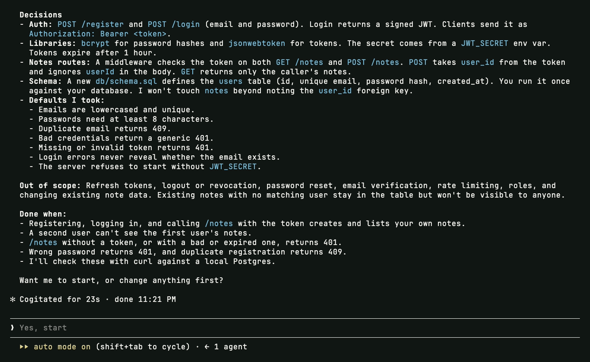

<p align="center">
  
</p>

<h1 align="center">grill</h1>

<p align="center">Claude interviews you about a task before building it.<br>One question at a time, each with ready answers, until the plan is yours too.</p>

<p align="center">
  
</p>

## How it goes

<table>
<tr>
<td align="center" width="33%"><br><b>Reads first</b><br><sub>code, git, docs</sub></td>
<td align="center" width="33%"><br><b>Asks one thing</b><br><sub>with a recommendation</sub></td>
<td align="center" width="33%"><br><b>Sums up</b><br><sub>then waits for your yes</sub></td>
</tr>
<tr>
<td valign="top">Anything the code, the history or the docs already answer is never asked.</td>
<td valign="top">Each question comes as a form with two to four options and the one Claude would pick first. Every answer shapes the next question.</td>
<td valign="top">A short spec: the goal, every decision and default, what is out of scope, and how done will be checked. No code is written before you agree.</td>
</tr>
</table>

## One question at a time

<p align="center">
  
</p>

## The plan you agree on

<p align="center">
  
</p>

## When to use it

Run `/grill` with the task, for example `/grill add login to the api`, or just say "grill me" before a large or vague piece of work. It pairs with [prompt-boost](../prompt-boost), which improves every prompt automatically; grill is the deep, deliberate version for the tasks worth a real conversation first.

## Install

```
/plugin marketplace add Mhitaryan-Tigran/claude-plugins
/plugin install grill@tigran-macintosh
```

Restart Claude Code and run `/grill`. For updates on their own, open `/plugin` → **Marketplaces** → `tigran-macintosh` → **Enable auto-update**.

<sub>MIT · Tigran Macintosh</sub>
